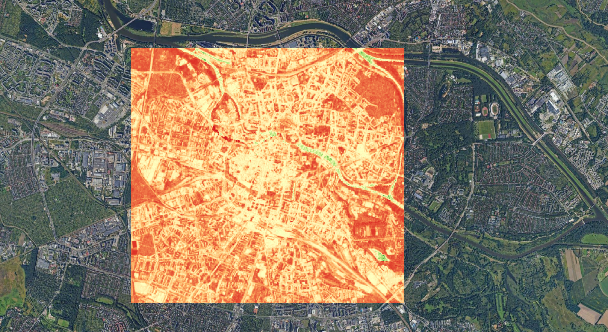
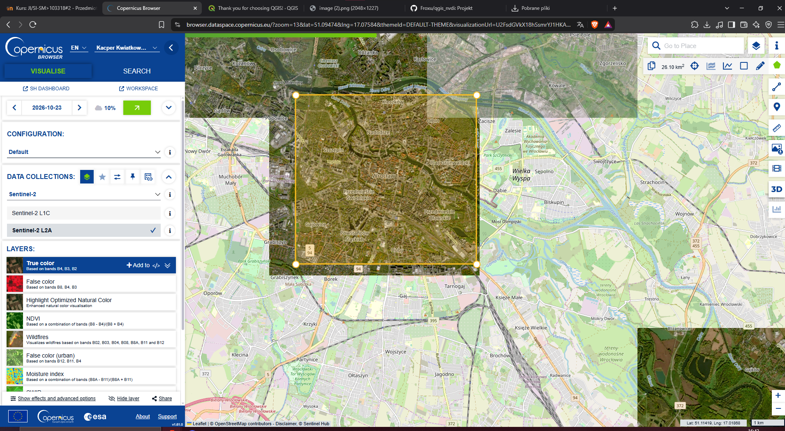
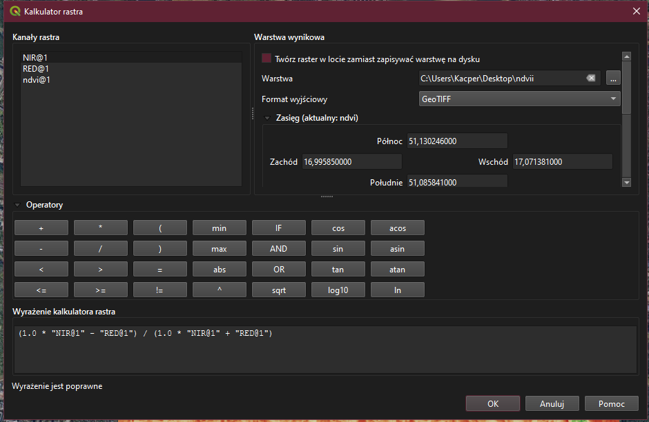
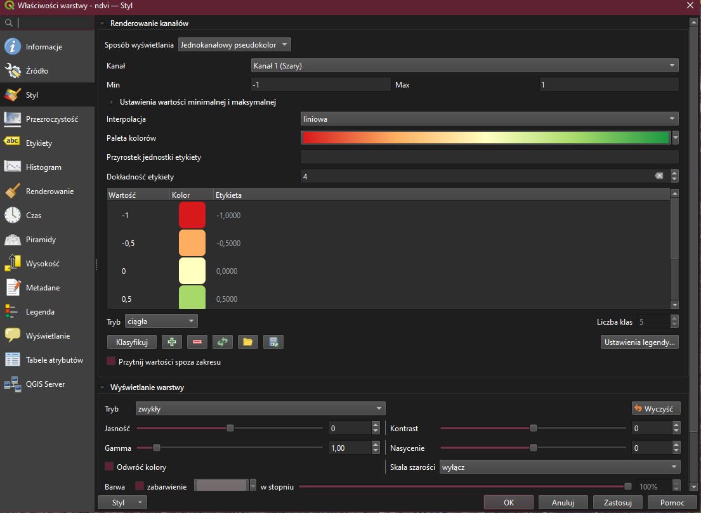

# NDVI - Wrocław

Obliczenie wskaźnika NDVI w QGIS na podstawie zobrazowań Sentinel-2 L2A (scena z 2026-10-23, Copernicus Data Space Browser). Obszar: centrum Wrocławia i okolice.

## Wzór

NDVI = (NIR - RED) / (NIR + RED)

Wyrażenie w Raster Calculator (QGIS):

```
("NIR@1" - "RED@1") / ("NIR@1" + "RED@1")
```

gdzie `RED` = pasmo B04, `NIR` = pasmo B08.

## Co zrobiłem

1. Pobrałem pasma B04 (RED) i B08 (NIR) z Copernicus Browser (Sentinel-2 L2A).
2. Utworzyłem projekt w QGIS i dodałem mapę podkładową (Google Satellite, XYZ Tiles).
3. Załadowałem warstwy B04 i B08, zmieniłem ich nazwy na `RED` i `NIR`.
4. Obliczyłem NDVI w Raster Calculator (Raster > Raster Calculator).
5. Ustawiłem symbolizację: Singleband pseudocolor, paleta RdYlGn.
6. Wyeksportowałem wynik jako `ndvi2.tif` (dane) oraz `ndvi.png` (mapa).

## Wynik



## Zrzuty ekranu

Pobieranie danych z Copernicus Browser:



Raster Calculator (wzór):



Symbolizacja (Singleband pseudocolor):



## Pliki

- `ndvi2.tif` - raster NDVI (surowe wartości)
- `ndvi.png` - kolorowa mapa NDVI
- `projekt.qgz` - projekt QGIS
- `screenshots/` - zrzuty ekranu z kolejnych kroków